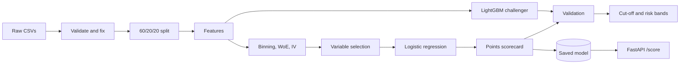

# Credit Risk Scorecard

A bank credit officer deciding on a new loan needs to know how likely the applicant is to default,
and why. This project builds an **application scorecard**: it predicts the probability of default,
turns it into a points score (higher = safer), recommends approve / refer / decline, and names the
three reasons that cost the applicant the most points.

> **Data note:** the results below come from **synthetic data** (100,000 generated applicants) that
> mimics the layout of Kaggle's Home Credit Default Risk files. They show that the method and code
> work. They are not evidence about real borrowers.

## Pipeline



## Results (synthetic data)

| Metric (TEST) | Scorecard | LightGBM | Target |
|---|---|---|---|
| Gini | **0.514** | 0.503 | >= 0.45 |
| KS | **0.385** | 0.375 | >= 0.30 |
| Score PSI, train vs test | 0.001 | | < 0.10 |
| Train minus test Gini | 0.046 (**misses**) | | <= 0.03 |

The scorecard stays champion. The synthetic risk signal is close to additive, so a more complex
model has little extra to find. The train-test gap miss is explained in [DECISIONS.md](DECISIONS.md).

At cut-off **545**: 80.6% of TEST applicants are approved, with a 4.86% bad rate among them
(against 7.84% overall), avoiding about half of all defaults.

### Points table (excerpt)

| Variable | Bin | WoE | Points |
|---|---|---|---|
| EXT_SOURCE_2 | below 0.274 | -0.898 | 18 |
| EXT_SOURCE_2 | 0.500 to 0.572 | -0.042 | 45 |
| EXT_SOURCE_2 | 0.75 and above | 0.828 | 73 |
| AGE_YEARS | under 25 | -0.504 | 32 |
| AGE_YEARS | 61 and over | 0.513 | 62 |

Full table: [reports/scorecard.csv](reports/scorecard.csv).

### Decile table (TEST, lowest scores first)

| Decile | Score range | Bad rate | Cumulative bads captured | Lift |
|---|---|---|---|---|
| 1 | 425-531 | 26.7% | 34.0% | 3.40 |
| 2 | 531-545 | 13.3% | 51.0% | 1.70 |
| 3 | 545-556 | 10.5% | 64.4% | 1.34 |
| 5 | 564-572 | 5.8% | 81.9% | 0.73 |
| 10 | 614-697 | 0.7% | 100% | 0.09 |

More: [model report](reports/model_report.md) and [run summary](reports/RUN_SUMMARY.md).

## Run it (Windows PowerShell, Python 3.11)

```powershell
python -m venv .venv
.venv\Scripts\python -m pip install -r requirements.lock
.venv\Scripts\python -m pip install --no-deps -e .
.venv\Scripts\python -m scorecard.pipeline --synthetic
.venv\Scripts\python -m pytest
.venv\Scripts\python -m uvicorn scorecard.api.main:create_app --factory --port 8000
```

Then open http://127.0.0.1:8000/docs. With `make` installed: `make setup`, `make pipeline`,
`make test`, `make api`.

### Get the real data

Accept the rules of the Kaggle competition *Home Credit Default Risk*, download the files into
`data/raw/`, and run `python -m scorecard.pipeline`.

## API example

The request fields are the raw inputs of whichever variables the model selected. Send `null` for an
unknown value.

```bash
curl -X POST http://127.0.0.1:8000/score -H "Content-Type: application/json" -d '{
  "EXT_SOURCE_1": 0.35, "EXT_SOURCE_2": 0.4, "EXT_SOURCE_3": 0.45,
  "DAYS_BIRTH": -11000, "DAYS_EMPLOYED": -900, "NAME_EDUCATION_TYPE": "Secondary",
  "AMT_INCOME_TOTAL": 150000, "AMT_CREDIT": 600000, "AMT_GOODS_PRICE": 500000,
  "BUR_DEBT_CREDIT_RATIO": 0.6, "INST_LATE_PAYMENT_RATE": 0.2,
  "INST_PAYMENT_RATIO_MEAN": 0.94, "PREV_APPROVED_RATE": 0.6}'
```

```json
{
  "score": 493, "pd": 0.4538, "risk_band": "E", "decision": "DECLINE",
  "reason_codes": [
    {"variable": "EXT_SOURCE_3", "points_lost": 42, "message": "Low external credit score (source 3)"},
    {"variable": "EXT_SOURCE_1", "points_lost": 40, "message": "Low external credit score (source 1)"},
    {"variable": "EXT_SOURCE_2", "points_lost": 37, "message": "Low external credit score (source 2)"}
  ],
  "points_breakdown": {"EXT_SOURCE_2": 36, "EXT_SOURCE_3": 40, "...": "..."},
  "model_version": "1.0.0"
}
```

Also available: `GET /health` and `POST /score/batch` (up to 1,000 applicants).

## Layout

| Path | Content |
|---|---|
| `config/` | Every threshold, plus reason-code messages and manual bin overrides |
| `src/scorecard/` | One module per pipeline stage; `scoring.py` is shared by batch and API |
| `tests/` | Formula checks, data checks, end-to-end run and API tests |
| `reports/` | Outputs of the latest full run |

## Key decisions

- **WoE + logistic regression** because every score can be explained point by point.
- **No class weighting**, so probabilities stay calibrated.
- **Everything is fitted on TRAIN only** to prevent leakage.
- **Cut-off chosen on VALIDATION** at a 5% target bad rate, then checked on TEST.

All deviations from the build spec are listed in [DECISIONS.md](DECISIONS.md).

## Limitations

- Synthetic data.
- No true out-of-time test: the source data has no application dates.
- No reject inference: only accepted applicants have outcomes.
- No fairness review. Age and gender need legal and ethical review before any real use.
- The API has no authentication or rate limiting; do not expose it publicly as is.
- The Docker image is built and health-checked in CI only, using a smoke-run model.
