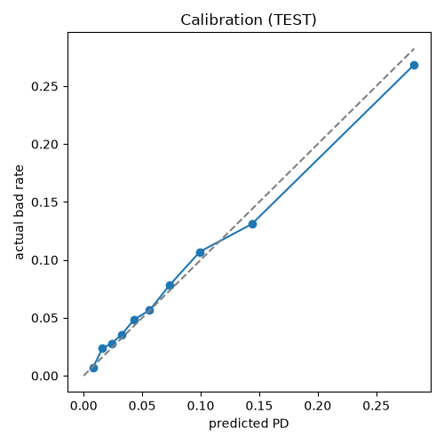
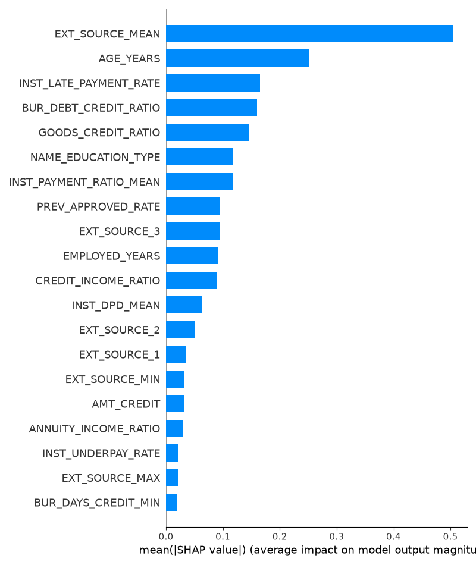

# Credit scorecard: model documentation

> **These results come from synthetic data** generated by `scorecard.synthetic`. They show that the
> pipeline works; they say nothing about real borrowers.

## 1. Executive summary

Purpose: estimate the probability that a new loan applicant defaults and express it as a points score.

- TEST Gini **0.514**, KS **0.385**
- Recommended cut-off: **545 (TEST approval rate 80.6%, bad rate among approved 4.86%)**
- Champion: **logistic scorecard**

## 2. Data

- Applicants: 100,000; bad rate 7.84%
- Tables: application, bureau, previous applications, instalment payments
- Fixes: the `DAYS_EMPLOYED = 365243` placeholder is set to missing and flagged; gender `XNA` is set to missing
- Columns dropped (judged on TRAIN): none

## 3. Sampling

Stratified 60/20/20 train/validation/test split with seed 42. The data has no application
date, so the pseudo out-of-time sample (highest ids within TEST) is only a proxy. A real
deployment needs a time-based holdout.

## 4. Feature engineering

See [feature_dictionary.csv](feature_dictionary.csv).

## 5. Binning and variable selection

| step | variables |
|---|---|
| candidates | 48 |
| iv_filter | 21 |
| correlation_filter | 14 |
| vif_filter | 13 |
| stepwise | 12 |
| sign_and_significance | 12 |

Information Value of the final variables:

| variable | iv |
|---|---|
| EXT_SOURCE_2 | 0.2336 |
| EXT_SOURCE_3 | 0.2393 |
| INST_LATE_PAYMENT_RATE | 0.1020 |
| AGE_YEARS | 0.1001 |
| EXT_SOURCE_1 | 0.1100 |
| BUR_DEBT_CREDIT_RATIO | 0.0600 |
| CREDIT_INCOME_RATIO | 0.0384 |
| EMPLOYED_YEARS | 0.0374 |
| NAME_EDUCATION_TYPE | 0.0384 |
| INST_PAYMENT_RATIO_MEAN | 0.0485 |
| GOODS_CREDIT_RATIO | 0.0415 |
| PREV_APPROVED_RATE | 0.0229 |

WoE charts are in [figures/binning](figures/binning/).

## 6. Model

Unregularised logistic regression on WoE values. Intercept -2.4703.

| variable | source | beta | vif |
|---|---|---|---|
| EXT_SOURCE_2 | application | -1.0895 | 1.0002 |
| EXT_SOURCE_3 | application | -1.0930 | 1.0003 |
| INST_LATE_PAYMENT_RATE | instalments | -1.1217 | 1.0003 |
| AGE_YEARS | application | -1.0228 | 1.0114 |
| EXT_SOURCE_1 | application | -1.0795 | 1.0002 |
| BUR_DEBT_CREDIT_RATIO | bureau | -1.0757 | 1.0001 |
| CREDIT_INCOME_RATIO | application | -1.0589 | 1.0002 |
| EMPLOYED_YEARS | application | -0.9088 | 1.0114 |
| NAME_EDUCATION_TYPE | application | -1.1127 | 1.0002 |
| INST_PAYMENT_RATIO_MEAN | instalments | -1.1055 | 1.0002 |
| GOODS_CREDIT_RATIO | application | -1.0951 | 1.0001 |
| PREV_APPROVED_RATE | previous | -1.0998 | 1.0001 |

## 7. Scorecard

Base score 600.0 at odds 50.0:1, PDO 20.0.

| variable | range | woe | points |
|---|---|---|---|
| EXT_SOURCE_2 | [-inf, 0.2743) | -0.8983 | 18 |
| EXT_SOURCE_2 | [0.2743, 0.3924) | -0.5078 | 31 |
| EXT_SOURCE_2 | [0.3924, 0.46) | -0.3391 | 36 |
| EXT_SOURCE_2 | [0.46, 0.4993) | -0.1878 | 41 |
| EXT_SOURCE_2 | [0.4993, 0.5716) | -0.0425 | 45 |
| EXT_SOURCE_2 | [0.5716, 0.6547) | 0.2293 | 54 |
| EXT_SOURCE_2 | [0.6547, 0.75) | 0.4827 | 62 |
| EXT_SOURCE_2 | [0.75, inf) | 0.8281 | 73 |
| EXT_SOURCE_2 | Missing | -0.0415 | 45 |
| EXT_SOURCE_3 | [-inf, 0.3221) | -0.8575 | 19 |
| EXT_SOURCE_3 | [0.3221, 0.4267) | -0.5503 | 29 |
| EXT_SOURCE_3 | [0.4267, 0.5053) | -0.2135 | 40 |
| EXT_SOURCE_3 | [0.5053, 0.6122) | 0.0915 | 49 |
| EXT_SOURCE_3 | [0.6122, 0.6834) | 0.3224 | 57 |
| EXT_SOURCE_3 | [0.6834, 0.7493) | 0.5721 | 65 |
| EXT_SOURCE_3 | [0.7493, 0.8267) | 0.7938 | 72 |
| EXT_SOURCE_3 | [0.8267, inf) | 1.1306 | 82 |
| EXT_SOURCE_3 | Missing | 0.0484 | 48 |
| INST_LATE_PAYMENT_RATE | [-inf, 0.04881) | 0.2908 | 56 |
| INST_LATE_PAYMENT_RATE | [0.04881, 0.07846) | 0.1160 | 50 |
| INST_LATE_PAYMENT_RATE | [0.07846, 0.1044) | 0.1139 | 50 |
| INST_LATE_PAYMENT_RATE | [0.1044, 0.1348) | -0.0026 | 46 |
| INST_LATE_PAYMENT_RATE | [0.1348, 0.1732) | -0.1427 | 42 |
| INST_LATE_PAYMENT_RATE | [0.1732, 0.2094) | -0.1547 | 42 |
| INST_LATE_PAYMENT_RATE | [0.2094, 0.3101) | -0.3775 | 34 |
| INST_LATE_PAYMENT_RATE | [0.3101, inf) | -0.7278 | 23 |
| AGE_YEARS | [-inf, 24.96) | -0.5042 | 32 |
| AGE_YEARS | [24.96, 29.83) | -0.3822 | 35 |
| AGE_YEARS | [29.83, 34.85) | -0.1737 | 41 |
| AGE_YEARS | [34.85, 42.65) | -0.1082 | 43 |
| AGE_YEARS | [42.65, 50.95) | 0.1234 | 50 |
| AGE_YEARS | [50.95, 58.87) | 0.2753 | 55 |
| AGE_YEARS | [58.87, 61.34) | 0.3849 | 58 |
| AGE_YEARS | [61.34, inf) | 0.5127 | 62 |
| EXT_SOURCE_1 | [-inf, 0.2718) | -0.9356 | 17 |
| EXT_SOURCE_1 | [0.2718, 0.3958) | -0.4967 | 31 |
| EXT_SOURCE_1 | [0.3958, 0.5024) | -0.2523 | 39 |
| EXT_SOURCE_1 | [0.5024, 0.5665) | 0.0648 | 49 |
| EXT_SOURCE_1 | [0.5665, 0.6714) | 0.2126 | 53 |
| EXT_SOURCE_1 | [0.6714, 0.7673) | 0.3617 | 58 |
| EXT_SOURCE_1 | [0.7673, 0.8164) | 0.5818 | 65 |
| EXT_SOURCE_1 | [0.8164, inf) | 0.7918 | 71 |
| EXT_SOURCE_1 | Missing | 0.0253 | 47 |
| BUR_DEBT_CREDIT_RATIO | [-inf, 0.09116) | 0.5057 | 62 |
| BUR_DEBT_CREDIT_RATIO | [0.09116, 0.2439) | 0.3841 | 58 |
| BUR_DEBT_CREDIT_RATIO | [0.2439, 0.3681) | 0.1311 | 51 |
| BUR_DEBT_CREDIT_RATIO | [0.3681, 0.5388) | -0.0425 | 45 |
| BUR_DEBT_CREDIT_RATIO | [0.5388, 0.5898) | -0.1102 | 43 |
| BUR_DEBT_CREDIT_RATIO | [0.5898, 0.6484) | -0.2663 | 38 |
| BUR_DEBT_CREDIT_RATIO | [0.6484, 0.7497) | -0.3692 | 35 |
| BUR_DEBT_CREDIT_RATIO | [0.7497, inf) | -0.5946 | 28 |
| BUR_DEBT_CREDIT_RATIO | Missing | -0.0005 | 47 |
| CREDIT_INCOME_RATIO | [-inf, 1.415) | 0.3349 | 57 |
| CREDIT_INCOME_RATIO | [1.415, 2.08) | 0.2274 | 53 |
| CREDIT_INCOME_RATIO | [2.08, 2.952) | 0.0914 | 49 |
| CREDIT_INCOME_RATIO | [2.952, 3.262) | 0.0629 | 48 |
| CREDIT_INCOME_RATIO | [3.262, 3.815) | -0.0322 | 46 |
| CREDIT_INCOME_RATIO | [3.815, 4.848) | -0.1051 | 43 |
| CREDIT_INCOME_RATIO | [4.848, 5.961) | -0.2146 | 40 |
| CREDIT_INCOME_RATIO | [5.961, inf) | -0.3980 | 34 |
| EMPLOYED_YEARS | [-inf, 1.825) | -0.1611 | 42 |
| EMPLOYED_YEARS | [1.825, 4.344) | -0.0983 | 44 |
| EMPLOYED_YEARS | [4.344, 6.449) | -0.0276 | 46 |
| EMPLOYED_YEARS | [6.449, 9.403) | 0.0657 | 48 |
| EMPLOYED_YEARS | [9.403, 13.66) | 0.2956 | 54 |
| EMPLOYED_YEARS | [13.66, inf) | 0.6497 | 64 |
| EMPLOYED_YEARS | Missing | 0.0135 | 47 |
| NAME_EDUCATION_TYPE | Higher education | 0.3722 | 58 |
| NAME_EDUCATION_TYPE | Incomplete higher | 0.0389 | 48 |
| NAME_EDUCATION_TYPE | Secondary | -0.0868 | 44 |
| NAME_EDUCATION_TYPE | Lower secondary | -0.3154 | 36 |
| INST_PAYMENT_RATIO_MEAN | [-inf, 0.896) | -0.5660 | 28 |
| INST_PAYMENT_RATIO_MEAN | [0.896, 0.9347) | -0.2855 | 37 |
| INST_PAYMENT_RATIO_MEAN | [0.9347, 0.9489) | -0.0808 | 44 |
| INST_PAYMENT_RATIO_MEAN | [0.9489, 0.961) | 0.0089 | 47 |
| INST_PAYMENT_RATIO_MEAN | [0.961, 0.9805) | 0.0429 | 48 |
| INST_PAYMENT_RATIO_MEAN | [0.9805, inf) | 0.1659 | 52 |
| GOODS_CREDIT_RATIO | [-inf, 0.7312) | -0.2869 | 37 |
| GOODS_CREDIT_RATIO | [0.7312, 0.7526) | -0.2719 | 38 |
| GOODS_CREDIT_RATIO | [0.7526, 0.7711) | -0.2301 | 39 |
| GOODS_CREDIT_RATIO | [0.7711, 0.7879) | -0.0785 | 44 |
| GOODS_CREDIT_RATIO | [0.7879, 0.829) | -0.0585 | 45 |
| GOODS_CREDIT_RATIO | [0.829, 0.8655) | -0.0297 | 46 |
| GOODS_CREDIT_RATIO | [0.8655, 0.9062) | 0.1001 | 50 |
| GOODS_CREDIT_RATIO | [0.9062, inf) | 0.2681 | 55 |
| PREV_APPROVED_RATE | [-inf, 0.4365) | -0.3395 | 36 |
| PREV_APPROVED_RATE | [0.4365, 0.6833) | -0.0809 | 44 |
| PREV_APPROVED_RATE | [0.6833, 0.8091) | -0.0509 | 45 |
| PREV_APPROVED_RATE | [0.8091, inf) | 0.1125 | 50 |
| PREV_APPROVED_RATE | Missing | -0.0089 | 46 |

## 8. Validation

| sample | rows | bad_rate | auc | gini | ks |
|---|---|---|---|---|---|
| train | 60000 | 0.0784 | 0.7800 | 0.5601 | 0.4222 |
| validation | 20000 | 0.0784 | 0.7573 | 0.5146 | 0.3849 |
| test | 20000 | 0.0784 | 0.7571 | 0.5142 | 0.3855 |
| pseudo_oot | 6000 | 0.0835 | 0.7579 | 0.5159 | 0.3830 |

TRAIN minus TEST Gini: 0.0458 (flagged)

Decile table (TEST):

| decile | min_score | max_score | count | bads | bad_rate | cum_pct_bads | cum_pct_goods | ks | lift |
|---|---|---|---|---|---|---|---|---|---|
| 1 | 425 | 531 | 2000 | 533 | 0.2665 | 0.3401 | 0.0796 | 0.2606 | 3.4014 |
| 2 | 531 | 545 | 2000 | 266 | 0.1330 | 0.5099 | 0.1737 | 0.3362 | 1.6975 |
| 3 | 545 | 556 | 2000 | 210 | 0.1050 | 0.6439 | 0.2708 | 0.3731 | 1.3401 |
| 4 | 556 | 564 | 2000 | 160 | 0.0800 | 0.7460 | 0.3706 | 0.3754 | 1.0211 |
| 5 | 564 | 572 | 2000 | 115 | 0.0575 | 0.8194 | 0.4728 | 0.3466 | 0.7339 |
| 6 | 572 | 581 | 2000 | 91 | 0.0455 | 0.8775 | 0.5764 | 0.3011 | 0.5807 |
| 7 | 581 | 590 | 2000 | 76 | 0.0380 | 0.9260 | 0.6808 | 0.2452 | 0.4850 |
| 8 | 590 | 600 | 2000 | 56 | 0.0280 | 0.9617 | 0.7863 | 0.1755 | 0.3574 |
| 9 | 600 | 614 | 2000 | 46 | 0.0230 | 0.9911 | 0.8923 | 0.0988 | 0.2936 |
| 10 | 614 | 697 | 2000 | 14 | 0.0070 | 1.0000 | 1.0000 | 0.0000 | 0.0893 |

Bad-rate reversals across deciles: 0

Calibration: Brier 0.0660, Hosmer-Lemeshow 17.43 (p = 0.026)

Stability:

| variable | comparison | psi | flag |
|---|---|---|---|
| score | train vs test | 0.0009 | stable |
| score | train vs application_test | 0.0005 | stable |
| EXT_SOURCE_2 | train vs application_test | 0.0005 | stable |
| EXT_SOURCE_3 | train vs application_test | 0.0005 | stable |
| INST_LATE_PAYMENT_RATE | train vs application_test | 0.0003 | stable |
| AGE_YEARS | train vs application_test | 0.0006 | stable |
| EXT_SOURCE_1 | train vs application_test | 0.0004 | stable |
| BUR_DEBT_CREDIT_RATIO | train vs application_test | 0.0003 | stable |
| CREDIT_INCOME_RATIO | train vs application_test | 0.0001 | stable |
| EMPLOYED_YEARS | train vs application_test | 0.0003 | stable |
| NAME_EDUCATION_TYPE | train vs application_test | 0.0001 | stable |
| INST_PAYMENT_RATIO_MEAN | train vs application_test | 0.0003 | stable |
| GOODS_CREDIT_RATIO | train vs application_test | 0.0004 | stable |
| PREV_APPROVED_RATE | train vs application_test | 0.0004 | stable |

## 9. Challenger comparison

| model | sample | auc | gini | ks |
|---|---|---|---|---|
| scorecard | test | 0.7571 | 0.5142 | 0.3855 |
| scorecard | pseudo_oot | 0.7579 | 0.5159 | 0.3830 |
| lightgbm | test | 0.7515 | 0.5029 | 0.3754 |
| lightgbm | pseudo_oot | 0.7532 | 0.5064 | 0.3844 |

Gini uplift of LightGBM over the scorecard: -0.0113. The uplift is not above the 0.05 threshold, so the logistic scorecard is recommended.

Trade-offs: the challenger can capture interactions and non-linear effects, but a points table is
easier to explain to customers and regulators, easier to monitor, and gives direct reason codes.

## 10. Strategy

Cut-off chosen on VALIDATION at a target bad rate of 5.0%, reported on TEST.

| cutoff | approval_rate | bad_rate_approved | bads_avoided | pct_bads_avoided |
|---|---|---|---|---|
| 425 | 1.0000 | 0.0784 | 0 | 0.0000 |
| 430 | 1.0000 | 0.0783 | 1 | 0.0006 |
| 435 | 1.0000 | 0.0783 | 1 | 0.0006 |
| 440 | 0.9999 | 0.0782 | 3 | 0.0019 |
| 445 | 0.9998 | 0.0782 | 3 | 0.0019 |
| 450 | 0.9998 | 0.0782 | 4 | 0.0026 |
| 455 | 0.9997 | 0.0781 | 5 | 0.0032 |
| 460 | 0.9996 | 0.0781 | 6 | 0.0038 |
| 465 | 0.9995 | 0.0780 | 8 | 0.0051 |
| 470 | 0.9994 | 0.0780 | 8 | 0.0051 |
| 475 | 0.9990 | 0.0776 | 17 | 0.0108 |
| 480 | 0.9978 | 0.0770 | 31 | 0.0198 |
| 485 | 0.9961 | 0.0765 | 43 | 0.0274 |
| 490 | 0.9931 | 0.0753 | 72 | 0.0459 |
| 495 | 0.9898 | 0.0741 | 100 | 0.0638 |
| 500 | 0.9859 | 0.0730 | 128 | 0.0817 |
| 505 | 0.9800 | 0.0715 | 166 | 0.1059 |
| 510 | 0.9727 | 0.0694 | 216 | 0.1378 |
| 515 | 0.9610 | 0.0672 | 275 | 0.1755 |
| 520 | 0.9472 | 0.0648 | 339 | 0.2163 |
| 525 | 0.9282 | 0.0613 | 429 | 0.2738 |
| 530 | 0.9071 | 0.0582 | 512 | 0.3267 |
| 535 | 0.8780 | 0.0548 | 605 | 0.3861 |
| 540 | 0.8446 | 0.0516 | 696 | 0.4442 |
| 545 | 0.8064 | 0.0486 | 783 | 0.4997 |
| 550 | 0.7619 | 0.0452 | 879 | 0.5609 |
| 555 | 0.7129 | 0.0404 | 991 | 0.6324 |
| 560 | 0.6595 | 0.0367 | 1083 | 0.6911 |
| 565 | 0.5988 | 0.0332 | 1170 | 0.7466 |
| 570 | 0.5383 | 0.0306 | 1237 | 0.7894 |
| 575 | 0.4764 | 0.0270 | 1310 | 0.8360 |
| 580 | 0.4161 | 0.0246 | 1362 | 0.8692 |
| 585 | 0.3582 | 0.0218 | 1411 | 0.9004 |
| 590 | 0.3007 | 0.0195 | 1450 | 0.9253 |
| 595 | 0.2474 | 0.0164 | 1486 | 0.9483 |
| 600 | 0.2016 | 0.0149 | 1507 | 0.9617 |
| 605 | 0.1631 | 0.0141 | 1521 | 0.9706 |
| 610 | 0.1278 | 0.0098 | 1542 | 0.9840 |
| 615 | 0.0974 | 0.0072 | 1553 | 0.9911 |
| 620 | 0.0723 | 0.0062 | 1558 | 0.9943 |
| 625 | 0.0536 | 0.0075 | 1559 | 0.9949 |
| 630 | 0.0374 | 0.0054 | 1563 | 0.9974 |
| 635 | 0.0261 | 0.0038 | 1565 | 0.9987 |
| 640 | 0.0177 | 0.0028 | 1566 | 0.9994 |
| 645 | 0.0121 | 0.0000 | 1567 | 1.0000 |
| 650 | 0.0084 | 0.0000 | 1567 | 1.0000 |
| 655 | 0.0053 | 0.0000 | 1567 | 1.0000 |
| 660 | 0.0034 | 0.0000 | 1567 | 1.0000 |
| 665 | 0.0020 | 0.0000 | 1567 | 1.0000 |
| 670 | 0.0010 | 0.0000 | 1567 | 1.0000 |
| 675 | 0.0006 | 0.0000 | 1567 | 1.0000 |
| 680 | 0.0003 | 0.0000 | 1567 | 1.0000 |
| 685 | 0.0002 | 0.0000 | 1567 | 1.0000 |
| 690 | 0.0001 | 0.0000 | 1567 | 1.0000 |
| 695 | 0.0001 | 0.0000 | 1567 | 1.0000 |

Risk bands (TEST):

| band | min_score | max_score | count | bad_rate |
|---|---|---|---|---|
| A | 600 | 697 | 4031 | 0.0149 |
| B | 581 | 599 | 4043 | 0.0334 |
| C | 564 | 580 | 4190 | 0.0516 |
| D | 545 | 563 | 3864 | 0.0965 |
| E | 425 | 544 | 3872 | 0.2022 |

## 11. Limitations and next steps

- No true out-of-time sample, because the data has no dates.
- No reject inference: the model only learns from applicants who were given a loan.
- Assumes future through-the-door applicants resemble this population.
- No fairness review. Gender and age need legal and ethical review before real use.
- Monitoring plan: monthly PSI and CSI; investigate at 0.1, act at 0.25.
